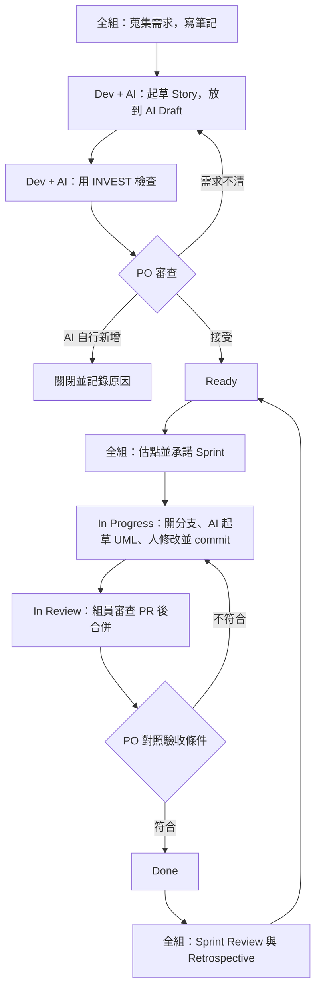

# Agile + AI 工作流程

本文件說明本組如何結合 Agile、AI 與 BMAD 完成期中專案。

核心原則：**AI 可以起草，只有人可以接受，每次使用都要記錄。**

## 專案資訊

| 項目 | 內容 |
|---|---|
| 題目 | [二手書交易平台](https://claude.ai/artifact/45bP7bdGCfo4SwNeKEkFFC) |
| Repo | [cm4578/SE-2026](https://github.com/cm4578/SE-2026) |
| 看板 | [軟體工程Agile](https://github.com/users/cm4578/projects/1) |
| 成員 | `cm4578`、`GaoJie0648`，共兩人 |
| 架構制定完成 | 2026-11-08 |
| 繳交截止日 | 待確認 |
| 繳交程式碼 | 需要 |
| 本文件範圍 | 只涵蓋 Agile + AI，不含 Waterfall |
| BMAD | 已確認可以使用 |

## 工作流總覽



### 三個不能省略的人工關卡

1. PO 接受 Story，才能進入 Ready。
2. 團隊自己估點，並承諾 Sprint。
3. 組員審查 PR，PO 驗收後才能進入 Done。

## 角色

本組只有兩人，因此一人擔任 PO，另一人兼任 SM 與主要 Developer。

| 成員 | 角色 | 職責 |
|---|---|---|
| `cm4578` | Product Owner（PO） | 決定優先順序，接受或拒絕 Story，驗收成果，審查對方的 PR |
| `GaoJie0648` | Scrum Master（SM）＋ Developer | 維護看板、Daily 紀錄與 `docs/ai-log.md`，操作 AI 起草與檢查 Story、拆 Task、畫 UML |

兩人協作時要遵守：

- 操作 AI 起草的人，不能接受同一份內容。
- PR 作者不能審查自己的 PR。
- 兩人都要了解全部內容，因為任何成員都可能被要求解釋報告或程式碼。

BMAD 的 PM 是 AI 角色，不等於 PO。報告要寫清楚 AI 只負責提案，由真人 PO 接受。

## 準備工作（Sprint 0）

1. 把題目規格書匯出到 `docs/notes/product-spec.md`，並建立 `docs/ai-log.md`。
2. 在 Repo 根目錄安裝 BMAD v6.12。需要 Node.js 20.12+、Python 3.10+ 與 uv。

   ```powershell
   npx bmad-method install
   ```

3. 確認兩人都有 Project 的寫入權限。
4. 設定 Project：
   - **Status**：Backlog → AI Draft → Ready → In Progress → In Review → Done
   - **Story Points**：Number 欄位
   - **Sprint**：Iteration 欄位，在網頁上建立
   - **標籤**：`ai-drafted`、`ambiguous`、`missing`、`ai-invented`
5. 依 [`GITFLOW.md`](GITFLOW.md) 建立 `develop`，並設定 `main` 與 `develop` 的分支保護，合併 PR 至少要另一人核准。
6. 確認 Project 與 Repo 助教都能開啟，並定期截圖保留。

## 單一 Story 流程

以下用「二手書交易平台」當例子。

### 1. 蒐集需求（全組）

以題目規格書為起點，討論後把補充筆記寫進 `docs/notes/`。不要放機密資料或個資。

### 2. AI 起草（Developer）

```text
bmad-spec 根據 docs/notes/product-spec.md 起草 User Story，
每條附 Given/When/Then 驗收條件。筆記沒提到的需求，
不要自行補上，改列成待確認問題。
```

把輸出建成 Issue，加上 `ai-drafted`，放到 AI Draft 欄，並記錄到 `docs/ai-log.md`。

Story 格式：

```markdown
身為 <使用者>，我想要 <功能>，以便 <價值>。

## 驗收條件
- [ ] Given ... When ... Then ...

## AI 紀錄
- 工具／模型：
- 起草者：
- 待確認問題：
```

### 3. 檢查 Story（Developer）

```text
bmad-review 用 adversarial 視角檢查 Issue #12，
另外逐項對照 INVEST，找出模糊、遺漏或筆記沒提到的內容。
```

把結果貼到 Issue 留言。

### 4. PO 審查（PO）

| 結果 | 動作 |
|---|---|
| 接受 | 留言記錄接受內容與修改，移到 Ready |
| 需求不清 | 加上 `ambiguous` 或 `missing`，修改後再審 |
| AI 自行新增 | 加上 `ai-invented`，以 "Close as not planned" 關閉並寫明原因 |

例如規格書已排除線上付款，AI 若提出金流功能，就屬於 `ai-invented`。

被拒絕的 Story 不要刪除，它們是報告需要的證據。

### 5. Sprint Planning（全組）

1. 依優先順序討論 Ready 欄的 Story。
2. 團隊先估點，再看 AI 的建議，差異大就討論。
3. 填寫 `Story Points` 與 `Sprint`。
4. 開一張 Sprint 紀錄 Issue，寫下目標與承諾的 Story。

### 6. 執行（Developer）

1. Story 移到 In Progress，並指派負責人。
2. 依 [`GITFLOW.md`](GITFLOW.md) 從 `develop` 開分支，例如 `docs/12-訂單流程循序圖`。
3. 請 AI 用 Mermaid 或 PlantUML 起草 UML，由人修改。
4. 由人 commit，message 遵守 [`COMMIT_CONVENTION.md`](COMMIT_CONVENTION.md)，issue 編號放在 footer：

   ```text
   docs: 新增訂單流程循序圖

   Refs #12
   ```

### 7. 審查 PR（另一人）

開 PR 到 `develop`，內文寫 `Refs #12`，Story 移到 In Review。審查者對照 Story 確認後，用「Create a merge commit」合併。

**PR 與 commit 都不要寫 `Closes #12`。** 合併時 Issue 會自動關閉，等於跳過 PO 驗收。

### 8. 驗收（PO）

PO 逐條核對驗收條件。全部符合就留言接受，手動關閉 Issue，並移到 Done。不符合就退回 In Progress。

## Sprint 固定節奏

11/8 前完成需求與架構制定，實作 Sprint 等繳交截止日確認後再排。

| 日期 | 階段 | 目標 |
|---|---|---|
| 11/1–11/2 | Sprint 0 | 完成準備工作，起草 Story，由 PO 接受 |
| 11/3–11/5 | Sprint 1 | 細化 Story 並估點，完成使用案例圖、循序圖、訂單狀態圖 |
| 11/6–11/8 | Sprint 2 | 完成類別圖與架構決策，包含技術棧、模組切分與資料模型 |
| 11/9 起 | 實作 Sprint | 依繳交截止日安排 |

### Daily（每天或隔幾天）

1. 每人在對應 Issue 更新進度。
2. SM 取得看板活動，請 AI 摘要：

   ```powershell
   gh issue list --state all --json number,title,state,updatedAt
   gh pr list --state all --json number,title,state,updatedAt
   ```

3. SM 校正後貼到 Sprint 紀錄 Issue，附上 Issue 與 PR 連結。

```markdown
### 11/05 Daily
- 完成：#12 循序圖，PR #15 已審查
- 進行中：#13 類別圖（負責人：<姓名>）
- 阻礙：#14 等 PO 確認爭議規則
- AI：摘要由 AI 產生，SM 修正 1 處
```

### Sprint Review

向全組展示完成的 Story，PO 確認成果，未完成的放回 Backlog。

### Retrospective

統計 `ai-invented`、`ambiguous`、`missing` 的數量，討論原因並決定改進項目。下一輪把改進項目寫進新的 Sprint 紀錄 Issue。

## BMAD 使用範圍

| 階段 | Skill | 用途 | 人工關卡 |
|---|---|---|---|
| 發想題目 | `bmad-brainstorming`、`bmad-forge-idea` | 發想與壓力測試 | 全組決定 |
| 筆記轉 Story | `bmad-spec`、`bmad-create-epics-and-stories` | 起草 Epic 與 Story | PO 接受 |
| 檢查 Story | `bmad-review`、`bmad-advanced-elicitation` | 找遺漏、做 pre-mortem | PO 決定 |
| 中途變更 | `bmad-correct-course` | 產出變更提案 | PO 與團隊決定 |
| 架構決策 | `bmad-architecture` | 記錄架構決策，作為 UML 參考 | 組員審查 PR |
| 討論需求 | `bmad-party-mode` | 多角色討論 | 僅供參考 |

### 不採用或需小心

| Skill | 原因 |
|---|---|
| `bmad-sprint-planning` | 會產生 sprint status 檔，和看板形成兩份進度 |
| `bmad-retrospective` | 只用於 Epic 驗收參考，接受 Story 的只能是 PO |
| `bmad-build-auto`、BMad Loop | 無人值守流程，違反人工接受原則 |
| `bmad-prd` | PRD 是 Waterfall 組的產出，避免影響方法比較 |

估點、Daily 摘要與 UML 由一般 AI 對話處理。BMAD 的 Story 經 PO 接受後，才同步到看板。

## AI 使用紀錄

每次使用 AI，都在 `docs/ai-log.md` 新增一列：

```markdown
| 日期 | 階段 | 工具／模型 | 問了什麼 | AI 產出 | 接受／拒絕及原因 | 核准者 | 時間 |
|---|---|---|---|---|---|---|---|
| 11/03 | 筆記轉 Story | bmad-spec / <模型> | 把訪談筆記轉成 Story | 6 條草稿 | 接受 4、修改 1、拒絕 1（付費功能為 AI 自行新增） | <PO 姓名> | 25 分鐘 |
```

## 報告對照

| 作業要求 | 資料來源 |
|---|---|
| AI in our process 表 | `docs/ai-log.md` |
| 審查發現的問題 | `ambiguous`、`missing`、`ai-invented` 標籤的 Issue |
| 看板流程展示 | Project 截圖、Issue、PR 連結 |
| 花費時間 | `docs/ai-log.md` 的時間欄 |
| 一頁 AI Usage Log | 從 `docs/ai-log.md` 精選，含一筆 AI 出錯的案例 |
| 組員分工表 | 角色表與 Issue 負責人 |