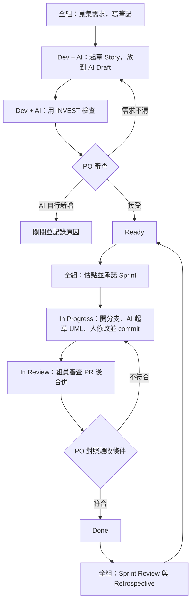

# Agile + AI 工作流程

本文件說明本組如何結合 Agile 與 AI 完成期中專案。

核心原則：**AI 可以起草，只有人可以接受，每次使用都要記錄。**

## 專案資訊

| 項目 | 內容 |
|---|---|
| 題目 | [二手書交易平台](https://claude.ai/artifact/45bP7bdGCfo4SwNeKEkFFC) |
| Repo | [cm4578/SE-2026](https://github.com/cm4578/SE-2026) |
| 看板 | [軟體工程Agile](https://github.com/users/cm4578/projects/1) |
| Wiki | [PO 決定](https://github.com/cm4578/SE-2026/wiki/PO-決定)、[AI 使用紀錄](https://github.com/cm4578/SE-2026/wiki/AI-使用紀錄) |
| 成員 | `cm4578`、`GaoJie0648`，共兩人 |
| 架構制定完成 | 2026-11-08 |
| 繳交截止日 | 待確認 |
| 繳交程式碼 | 需要 |
| 本文件範圍 | 只涵蓋 Agile + AI，不含 Waterfall |
| BMAD | 不採用，原因見「AI 使用範圍」 |
| Story 起草與檢查工具 | 待定 |
| Agile 組是否需交 SRS | 不需要 |

## 工作流總覽



### 三個不能省略的人工關卡

1. PO 接受 Story，才能進入 Ready。
2. 團隊自己估點，並承諾 Sprint。
3. 組員審查 PR，PO 驗收後才能進入 Done。

## 角色

本組只有兩人，因此一人擔任 PO，另一人兼任 SM 與主要 Developer。

| 成員 | 角色 | 職責 |
|---|---|---|
| `cm4578` | Product Owner（PO） | 決定優先順序，接受或拒絕 Story，驗收成果，審查對方的 PR |
| `GaoJie0648` | Scrum Master（SM）＋ Developer | 維護看板、會議紀錄與 Wiki 的「AI 使用紀錄」，操作 AI 起草與檢查 Story、拆 Task、畫 UML |

兩人協作時要遵守：

- 操作 AI 起草的人，不能接受同一份內容。
- PR 作者不能審查自己的 PR。
- 兩人都要了解全部內容，因為任何成員都可能被要求解釋報告或程式碼。

報告要寫清楚 AI 只負責提案，由真人 PO 接受。

## 紀錄放在哪裡

依內容的性質分成四個地方。同一件事只寫在一個地方，其他地方只放連結。

| 放在哪裡 | 放什麼 | 怎麼更新 |
|---|---|---|
| repo 的 `docs/` | 流程與規範、題目規格書、UML | 開 PR，由另一人審查 |
| [Wiki](https://github.com/cm4578/SE-2026/wiki) | 「PO 決定」與「AI 使用紀錄」 | 直接在網頁上編輯，不用開 PR |
| Sprint 紀錄 Issue | 所有會議紀錄 | 留言 |
| 看板 | Story 的進度 | 移動卡片 |

PO 決定與 AI 使用紀錄每天都會增加。放在 repo 要開 PR 才看得到，兩人在不同分支各加一列也會衝突，所以放在 Wiki。Wiki 的每次修改都會留下紀錄，可以在頁面的 History 查到誰在什麼時候改了什麼。

### PO 決定

1. 待確認問題由 PO 決定。AI 可以說明問題、提出選項，或依 PO 的回答整理文字，PO 確認後才存到 Wiki 的「PO 決定」。
2. 依日期加一個段落，每題用「Q<編號> <標題>」當小標題，例如 `### Q15 買家收件資訊`，Story 才能連到那一題。
3. 標明決定的來源：PO 自己回答，或是「AI 提議」「AI 解讀」「AI 推薦」後經 PO 採用。
4. 存檔後，在當期的 Sprint 紀錄 Issue 留言寫題號與 Wiki 連結。Wiki 改了不會通知組員，要靠這則留言通知。
5. 決定的內容只寫在 Wiki。Story、會議紀錄與其他文件只寫題號與連結。

## 準備工作（Sprint 0）

1. 把題目規格書匯出到 `docs/notes/product-spec.md`，並在 Wiki 建立「PO 決定」與「AI 使用紀錄」兩頁。
2. 確認兩人都有 Project 的寫入權限。
3. 設定 Project：
   - **Status**：Backlog → AI Draft → Ready → In Progress → In Review → Done
   - **Story Points**：Number 欄位
   - **Sprint**：Iteration 欄位，在網頁上建立
   - **標籤**：`ai-drafted`、`ambiguous`、`missing`、`ai-invented`
4. 依 [`GITFLOW.md`](GITFLOW.md) 建立 `develop`，並設定 `main` 與 `develop` 的分支保護，合併 PR 至少要另一人核准。
5. 確認 Project 與 Repo 助教都能開啟，並定期截圖保留。

## 單一 Story 流程

以下用「二手書交易平台」當例子。

### 1. 蒐集需求（全組）

以題目規格書為起點，討論後把補充筆記寫進 `docs/notes/`。PO 對待確認問題的決定寫進 Wiki 的「PO 決定」，見「紀錄放在哪裡」。不要放機密資料或個資。

### 2. AI 起草（Developer）

起草工具待定。不論使用哪個工具，prompt 都要包含下列要求：

```text
根據 docs/notes/product-spec.md 與 Wiki「PO 決定」起草 User Story，
每條附 Given/When/Then 驗收條件。兩者都沒提到的需求，
不要自行補上，改列成待確認問題。
```

把輸出建成 Issue，加上 `ai-drafted`，放到 AI Draft 欄，並記錄到 Wiki 的「AI 使用紀錄」。

Story 格式：

```markdown
身為 <使用者>，我想要 <功能>，以便 <價值>。

## 驗收條件
- [ ] Given ... When ... Then ...

## 需求來源
- 驗收條件 1：`docs/notes/<檔案>` 的「<段落>」
- 驗收條件 2：Wiki「PO 決定」的 [Q<編號>](<該題的連結>)

## AI 紀錄
- 工具／模型：
- 起草者：
- 待確認問題：
```

### 3. 檢查 Story（Developer）

檢查工具待定。不論使用哪個工具，prompt 都要包含下列要求：

```text
用挑錯的角度檢查 Issue #12，逐項對照 INVEST，
找出模糊、遺漏或筆記沒提到的內容。
```

把結果貼到 Issue 留言。

接著由人逐條核對「需求來源」。在 `docs/notes/` 與 Wiki「PO 決定」都找不到來源的驗收條件，在 Issue 留言列出並加上 `ai-invented`，由 PO 決定向利害關係人確認後補上來源，或從 Story 移除該條（原文保留在留言）；整條 Story 都沒有來源時，才依第 4 步關閉。

### 4. PO 審查（PO）

| 結果 | 動作 |
|---|---|
| 接受 | 留言記錄接受內容與修改，移到 Ready |
| 需求不清 | 加上 `ambiguous` 或 `missing`，PO 的決定寫進 Wiki「PO 決定」，修改後再審 |
| AI 自行新增 | 加上 `ai-invented`，以 "Close as not planned" 關閉並寫明原因 |

例如規格書已排除線上付款，AI 若提出金流功能，就屬於 `ai-invented`。

被拒絕的 Story 不要刪除，它們是報告需要的證據。

### 5. Sprint Planning（全組）

1. 依優先順序討論 Ready 欄的 Story。
2. 團隊先估點，再看 AI 的建議，差異大就討論。
3. 填寫 `Story Points` 與 `Sprint`。
4. 開一張 Sprint 紀錄 Issue，寫下目標與承諾的 Story。

### 6. 執行（Developer）

1. Story 移到 In Progress，並指派負責人。
2. 依 [`GITFLOW.md`](GITFLOW.md) 從 `develop` 開分支，例如 `docs/12-訂單流程循序圖`。
3. 請 AI 用 Mermaid 或 PlantUML 起草 UML，由人修改。
4. 由人 commit，message 遵守 [`COMMIT_CONVENTION.md`](COMMIT_CONVENTION.md)，issue 編號放在 footer：

   ```text
   docs: 新增訂單流程循序圖

   Refs #12
   ```

### 7. 審查 PR（另一人）

開 PR 到 `develop`，內文寫 `Refs #12`，Story 移到 In Review。審查者對照 Story 確認後，用「Create a merge commit」合併。

**PR 與 commit 都不要寫 `Closes #12`。** 合併時 Issue 會自動關閉，等於跳過 PO 驗收。

### 8. 驗收（PO）

PO 逐條核對驗收條件，並確認符合「完成標準」。全部符合就留言接受，手動關閉 Issue，並移到 Done。不符合就退回 In Progress。

## 完成標準（Done Criteria）

Story 必須符合下列全部條件，才能移到 Done。

- 驗收條件逐條符合，PO 已留言接受。
- PR 經作者以外的組員審查，並以「Create a merge commit」合併到 `develop`。
- AI 的使用已記錄到 Wiki 的「AI 使用紀錄」。
- AI 起草的 UML 已由人修改。
- 和 `docs/notes/product-spec.md`「品質要求」有關的 Story，設計或實作符合其中的一致性、安全與個資要求。

## Sprint 固定節奏

11/8 前完成需求與架構制定，實作 Sprint 等繳交截止日確認後再排。

| 日期 | 階段 | 目標 |
|---|---|---|
| 11/1–11/2 | Sprint 0 | 完成準備工作，起草 Story，由 PO 接受 |
| 11/3–11/5 | Sprint 1 | 細化 Story 並估點，完成使用案例圖、循序圖、訂單狀態圖 |
| 11/6–11/8 | Sprint 2 | 完成類別圖與架構決策，包含技術棧、模組切分與資料模型 |
| 11/9 起 | 實作 Sprint | 依繳交截止日安排 |

### 會議紀錄

每個 Sprint 在 Sprint Planning 時開一張 Sprint 紀錄 Issue（見「單一 Story 流程」第 5 步）：

1. 這個 Sprint 的所有會議，包括 Daily、臨時討論、Sprint Review 與 Retrospective，都在這張 Issue 留言。每則的標題寫日期和會議種類，例如「11/09 Daily」。
2. 會議中做的決定只寫題號與 Wiki 連結，內容寫在 Wiki 的「PO 決定」。
3. Sprint 結束時關閉這張 Issue，下一個 Sprint 再開一張新的。

### Daily（每天或隔幾天）

1. 每人在對應 Issue 更新進度。
2. SM 取得看板活動，請 AI 摘要：

   ```powershell
   gh issue list --state all --json number,title,state,updatedAt
   gh pr list --state all --json number,title,state,updatedAt
   ```

3. SM 校正後貼到 Sprint 紀錄 Issue，附上 Issue 與 PR 連結。

```markdown
### 11/05 Daily
- 完成：#12 循序圖，PR #15 已審查
- 進行中：#13 類別圖（負責人：<姓名>）
- 阻礙：#14 等 PO 確認爭議規則
- AI：摘要由 AI 產生，SM 修正 1 處
```

### Sprint Review

向全組展示完成的 Story，PO 確認成果，未完成的放回 Backlog。

### Retrospective

統計 `ai-invented`、`ambiguous`、`missing` 的數量，討論原因並決定改進項目。下一輪把改進項目寫進新的 Sprint 紀錄 Issue。

## AI 使用範圍

Story 起草與檢查的工具待定。不論使用哪個工具，都依下表區分：

| 可以交給 AI（產出必須由人檢查） | 禁止交給 AI |
|---|---|
| 依筆記起草候選 Story 與驗收條件 | 捏造筆記或規格書沒有的使用者、規則或數字 |
| 列出遺漏的邊界情況、錯誤流程與非功能需求 | 決定範圍與優先順序，例如 MVP 要做什麼 |
| 用 INVEST 檢查 Story，標出模糊用詞，拆分過大的 Story | 接受 Story，或判定是否通過驗收 |
| 起草 UML、建議拆分 Task、提供估點建議、摘要 Daily | 沒有人確認就 commit、push，或自動跑完整個流程 |
| | 核准或合併 PR、關閉 issue |
| | 接收機密資料或個資 |

### 不採用 BMAD 的原因

組員在 11/04 討論後決定不使用 BMAD，安裝用的 PR #4 已關閉，留言寫明原因：

1. BMAD 的主流程是 product brief → PRD → 架構 → Epic 與 Story → sprint planning → 實作，必須先寫 PRD。這是先寫完整需求文件、再交給工程師的做法，和 Agile 由 PO 與開發者直接溝通需求不同。
2. 用來拆 Story 的 `bmad-create-epics-and-stories`，執行前必須先有 PRD 與架構文件。
3. 部分 skill 違反「AI 起草、人接受」：`bmad-build-auto` 全程不詢問人，最後會自動 commit；`bmad-retrospective` 由 AI 判定驗收結果；`bmad-sprint-planning` 會另外產生進度檔，和看板形成兩份進度。

## AI 使用紀錄

每次使用 AI，都在 Wiki 的[「AI 使用紀錄」](https://github.com/cm4578/SE-2026/wiki/AI-使用紀錄)新增一列，直接在網頁上編輯。完整的 prompt 貼在對應 Issue 或 PR 的留言，「問了什麼」欄寫摘要並附上留言連結：

```markdown
| 日期 | 階段 | 工具／模型 | 問了什麼 | AI 產出 | 接受／拒絕及原因 | 核准者 | 時間 |
|---|---|---|---|---|---|---|---|
| 11/03 | 筆記轉 Story | <工具> / <模型> | 把訪談筆記轉成 Story | 6 條草稿 | 接受 4、修改 1、拒絕 1（付費功能為 AI 自行新增） | <PO 姓名> | 25 分鐘 |
```

## 報告對照

| 作業要求 | 資料來源 |
|---|---|
| AI in our process 表 | Wiki「AI 使用紀錄」 |
| 審查發現的問題 | `ambiguous`、`missing`、`ai-invented` 標籤的 Issue；Wiki「PO 決定」 |
| 看板流程展示 | Project 截圖、Issue、PR 連結 |
| 花費時間 | Wiki「AI 使用紀錄」的時間欄 |
| 一頁 AI Usage Log | 從 Wiki「AI 使用紀錄」精選，含一筆 AI 出錯的案例 |
| 組員分工表 | 角色表與 Issue 負責人 |